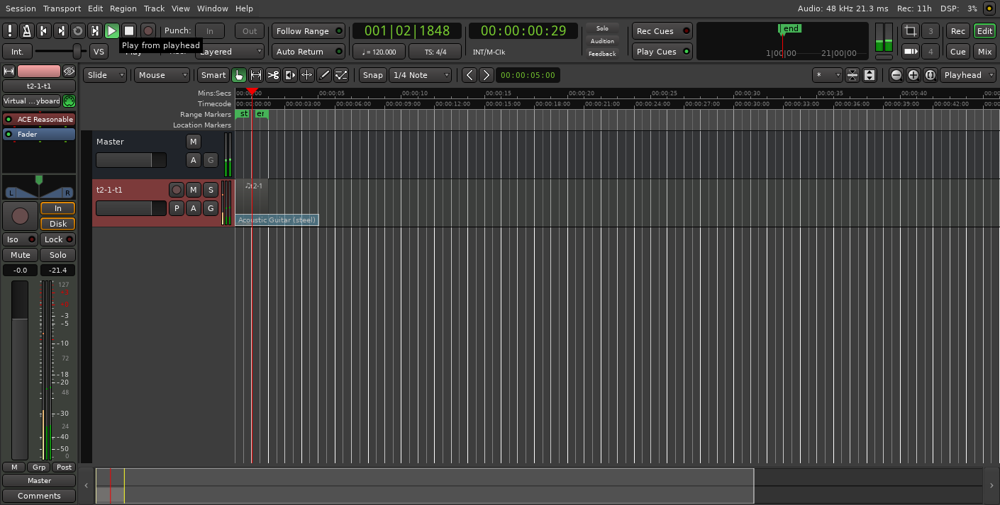

# Ardour 8.12 MIDI import and playback smoke

This tests **one synthetic bend/release**, not a real-checkpoint transcription,
GP5, a general DAW-compatibility claim or an exported MIDI round trip.
On Linux x86-64, Debian Ardour **8.12.0** was started with a 48 kHz PulseAudio
null sink and a new 120 BPM / 4/4 session. The test imported the MIDI generated
by `cargo run --locked -p mtab-export --example midi_bend_fixture` as a new
track, using Ardour's default **ACE Reasonable Synth**. The transport played
and the master meter showed audio; its null-sink monitor was captured for an
independent spectral sanity check. The virtual setup has no physical audio
output, so there was **no subjective listening test**.



The generated source has one MIDI 60 note, velocity 92, one program change,
a ±2-semitone pitch-sensitivity RPN, and 51 wheel events describing a linear
0 → 100 → 0-cent contour over one second. The source and the MIDI source
Ardour saved inside its session were parsed with Mido 1.3.3:

- The input was SMF type 1, PPQ 480; Ardour stored the imported source as type
  0, PPQ 19200. The note onset, offset, pitch, velocity, program change and all
  51 wheel values and musical times were identical.
- **The six original RPN controls were absent from the saved MIDI source.**
  Ardour added bank-selection controls. This check does not prove whether any
  equivalent sensitivity setting was stored elsewhere in the session. A
  synthesizer with a bend range other than two semitones can therefore sound
  different; do not assume the original RPN survives this import.
- Approximate FFT harmonic estimates on the captured playback, aligned by a
  0.001 amplitude onset threshold, were **13.5, 33.8, 53.9, 73.7, 93.4,
  86.4, 66.8, 48.0 cents** at 0.1 through 0.8 s. Ideal contour values at
  those times were 20, 40, 60, 80, 100, 80, 60, 40 cents. This gives a
  coarse rise-and-release sanity check only: onset and synth latency are not
  calibrated, and the synth's note decayed to silence before 0.9 s.

CI compares the checked-in Ardour saved source with a newly generated source,
and mutation-tests the comparator. It **does not install or run Ardour**; the
manual DAW import/playback is not repeated by CI. Test data and checks:

```sh
cargo run --locked -p mtab-export --example midi_bend_fixture -- /tmp/bend.mid
python -m pip install mido==1.3.3  # test only
python tools/test_ardour_midi_import.py /tmp/bend.mid \
  crates/mtab-export/tests/fixtures/ardour-8.12.0/bend-import.mid
```

The saved source is 334 bytes; neither the rendered audio nor synth is bundled.
See the [fixture README](../crates/mtab-export/tests/fixtures/ardour-8.12.0/README.md)
for SHA-256 identifiers and `NOTICE` for software licensing. Different Ardour
versions, import mappings, plugins, pitch-bend defaults, tracks or tempo maps
may behave differently. The original full DAW session was not committed.
